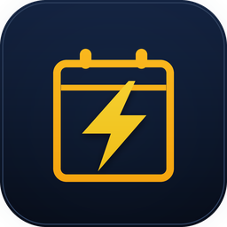
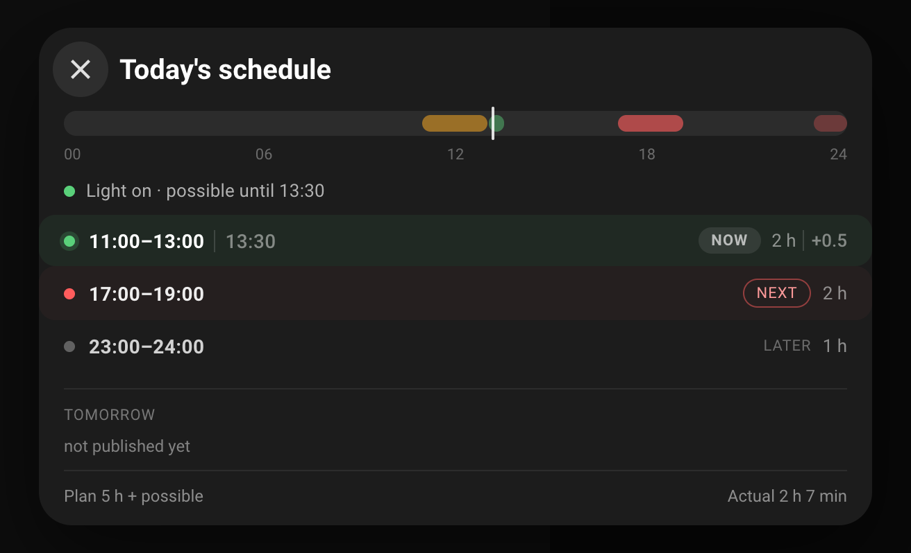
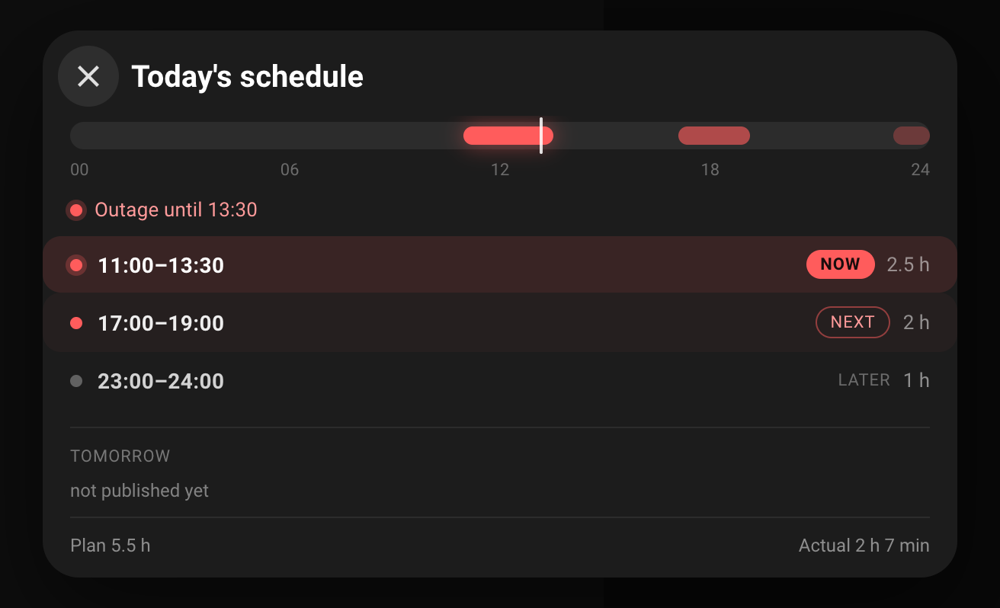
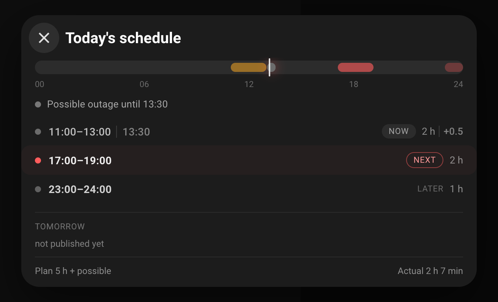
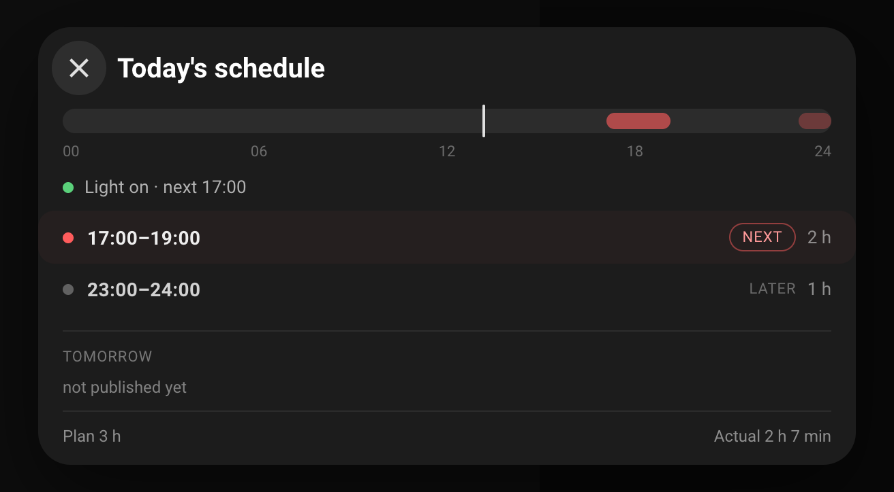
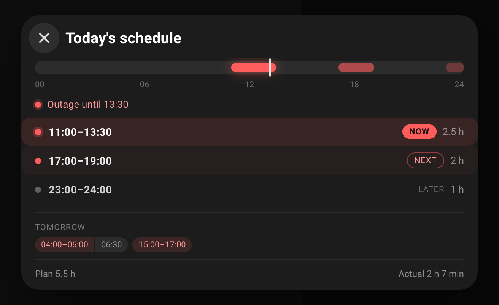
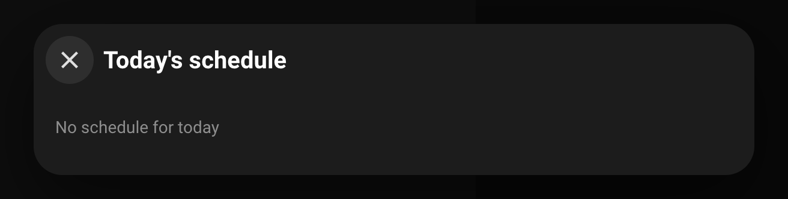
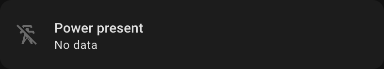

<p align="center"></p>

# Svitlo Poltava

[](https://hacs.xyz)
[](LICENSE)

Power outage schedule for **Poltava**, for Home Assistant. Choose your queue —
3.1 is the default.

The integration reads only the official Poltavaoblenergo page
`poe.pl.ua/customs/dynamicgpv-info.php`. No proxies, no other regions, no merge
of APIs, no Python dependencies.

The Lovelace card is included. It is a power tile; tap it and the schedule opens
in a native dialog with the same look the dashboard used with browser_mod —
without browser_mod. HACS installs the integration, and the card is loaded
automatically; no manual resource entry.

## Features

- Three states per half-hour slot: **on**, **off**, and **possible**.
- Today and tomorrow, when the operator publishes both.
- The next planned outage and the planned outage hours for today.
- One calendar entity with the outage windows.
- One config entry. The region is fixed; you choose the queue from the operator
  page.
- A bundled power tile and schedule dialog.
- Two languages: Ukrainian and English.

## Screenshots

The screenshots use sample schedule data.




### States

The card follows the real light, not only the plan.

#### Outage in effect



#### Possible window, light off



#### Light on during a planned window


#### Light on, next outage



#### Tomorrow published



#### No schedule



### Tile: light off / on / no data

| Off | On | No data |
| --- | --- | --- |
|  |  |  |

## Installation

1. Open **HACS → Integrations**.
2. Open the three-dot menu → **Custom repositories**.
3. Add `https://github.com/e-potashkin/svitlo_poltava` with category
   **Integration**.
4. Install **Svitlo Poltava** and restart Home Assistant.
5. Go to **Settings → Devices & services → Add integration → Svitlo Poltava**.

Choose your queue from the list. The list comes from the operator page; 3.1 is
the default.

## Card

The card is served from the integration and loaded on every page. Add it to a
dashboard:

```yaml
type: custom:svitlo-poltava-card
```

Every option is optional:

| Option | Default | Meaning |
| --- | --- | --- |
| `entity` | the only `sensor.svitlo_poltava_*_electricity` with a schedule | the schedule sensor |
| `presence_entity` | `binary_sensor.grid_present` if it exists, otherwise `binary_sensor.svitlo_poltava_{queue}_power_present` | the real light |
| `off_today_entity` | `sensor.grid_off_today` if it exists, otherwise none | measured outage hours; without it the footer prints `—` |
| `title` | `Power present` / `Наявність світла` | tile title |
| `dialog_title` | `Today's schedule` / `Графік на сьогодні` | dialog title |

The tile shows the real light. Tap it to open the 24-hour rail, one row per
window, tomorrow's windows, and the plan and measured hours. The dialog is a
native `<dialog>`: Escape and a backdrop click close it, and the close button
sits on the left like the browser_mod popup.

## Entities

The integration creates one device, **Svitlo Poltava {queue}** (for example,
**Svitlo Poltava 3.1**). Replace `{queue}` with the queue you chose:

| Entity | State |
| --- | --- |
| `sensor.svitlo_poltava_{queue}_electricity` | `Grid ON`, `Grid OFF`, `Possible`, `No data` |
| `binary_sensor.svitlo_poltava_{queue}_power_present` | power present / absent |
| `sensor.svitlo_poltava_{queue}_next_outage` | next planned outage (timestamp) |
| `sensor.svitlo_poltava_{queue}_total_outage_today` | planned outage hours today |
| `calendar.svitlo_poltava_{queue}_outage_schedule` | calendar of outage windows |

Entity IDs are generated from the device and entity names. If your Home
Assistant language is not English, the IDs can differ; check
**Settings → Devices & services → Svitlo Poltava**.

The status sensor carries the full schedule in its attributes:
`now_status`, `today_48half`, `tomorrow_48half`, `next_change_at`,
`today_outage_hours`, `tomorrow_outage_hours`, and `updated`. The calendar and
the card read the same data.

## Options

**Settings → Devices & services → Svitlo Poltava → Configure** changes two
things:

1. **Queue** — the list comes from the operator page. After a change the old
   entities and the old device are removed, and a new set is created with the
   new queue in its IDs.
2. **Update interval** — default 120 seconds, allowed range 60–600 seconds.

The card finds the schedule sensor automatically. If you rename the sensor, set
`entity` explicitly.

## Languages

The integration follows the Home Assistant profile language:

1. **Ukrainian** (`uk`) and **English** (`en`) are translated.
2. The config flow, options and entity names come from
   `translations/uk.json` and `translations/en.json`.
3. The card reads `hass.language`: `uk` for Ukrainian, everything else falls
   back to English.

The schedule data itself is language-neutral: it is 48 half-hour states plus
timestamps.

## Data source

`https://www.poe.pl.ua/customs/dynamicgpv-info.php`

The page contains one or more day blocks with a 48-cell table per queue. The
parser is in `custom_components/svitlo_poltava/poe_gpv.py`; the coordinator maps
the queue from the config entry to the 48 half-hour slots.

## Troubleshooting

1. **"No schedule for today"** — the operator has not published today yet. The
   sensor keeps the last known attributes and the card shows the empty state.
2. **"Possible" is not an outage.** It marks a window the operator warns about;
   the card draws it grey and never as a certain outage.
3. **Entity IDs differ from the table** — the IDs follow the Home Assistant
   language at install time. Search for `Svitlo Poltava` in
   **Settings → Devices & services** instead of copying an ID from the table.

## License

MIT. Copyright (c) 2026 e-potashkin.
