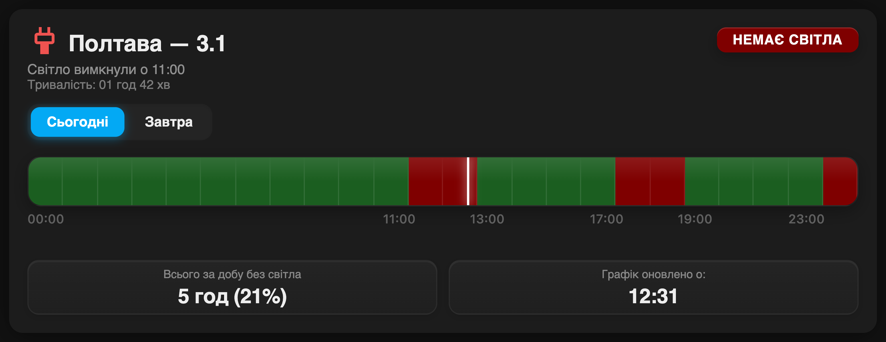
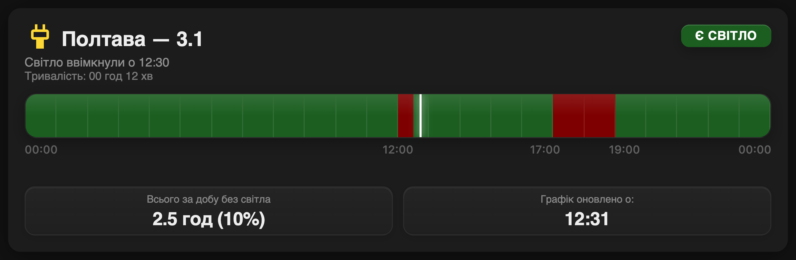

# Svitlo Poltava

Power outage schedule for **Poltava, queue 3.1**, for Home Assistant.

The integration reads only the official Poltavaoblenergo page
`poe.pl.ua/customs/dynamicgpv-info.php`. No proxies, no other regions, no merge
of two APIs, no Python dependencies.

The Lovelace card is included. HACS installs the integration, and the card is
loaded automatically — no manual resource entry.

## Screenshots





## Features

- Three states per half-hour slot: **on**, **off**, and **possible**.
- Today and tomorrow, when the operator publishes both.
- Next outage, next grid connection, minutes and hours to each.
- Outage hours for today and tomorrow, longest outage.
- One calendar entity with the outage windows.
- One config entry. The region and queue are fixed; there is nothing to choose.

## Installation

1. Open **HACS → Integrations**.
2. Open the three-dot menu → **Custom repositories**.
3. Add `https://github.com/e-potashkin/svitlo_poltava` with category
   **Integration**.
4. Install **Svitlo Poltava** and restart Home Assistant.
5. Go to **Settings → Devices & services → Add integration → Svitlo Poltava**.

The entry is created immediately. No region or queue selection is needed.

## Card

The card is served from the integration and loaded on every page. Add it to a
dashboard:

```yaml
type: custom:svitlo-poltava-card
entity: sensor.svitlo_poltava_3_1_electricity
title: Poltava — 3.1
```

The card draws a 24-hour timeline, the half-hour slots, the next window, the
outage hours, and the schedule update time. The visual editor can select the
calendar and the related sensors.

## Entities

The integration creates one device, **Svitlo Poltava 3.1**:

| Entity | State |
| --- | --- |
| `sensor.svitlo_poltava_3_1_electricity` | `Grid ON`, `Grid OFF`, `Possible`, `No data` |
| `binary_sensor.svitlo_poltava_3_1_power_present` | power present / absent |
| `binary_sensor.svitlo_poltava_3_1_emergency_outages` | emergency flag |
| `sensor.svitlo_poltava_3_1_next_outage` | next planned outage (timestamp) |
| `sensor.svitlo_poltava_3_1_next_grid_connection` | next grid connection (timestamp) |
| `sensor.svitlo_poltava_3_1_minutes_to_outage` | minutes to the next outage |
| `sensor.svitlo_poltava_3_1_minutes_to_grid_connection` | minutes to the next connection |
| `sensor.svitlo_poltava_3_1_next_power_off` | seconds to the next outage |
| `sensor.svitlo_poltava_3_1_next_power_on` | seconds to the next connection |
| `sensor.svitlo_poltava_3_1_schedule_updated` | schedule update time |
| `sensor.svitlo_poltava_3_1_total_outage_today` | outage hours today |
| `sensor.svitlo_poltava_3_1_total_outage_tomorrow` | outage hours tomorrow |
| `sensor.svitlo_poltava_3_1_longest_outage` | longest outage |
| `calendar.svitlo_poltava_3_1_outage_schedule` | calendar of outage windows |

Entity IDs are generated from the device and entity names. If your Home
Assistant language is not English, the IDs can differ; check
**Settings → Devices & services → Svitlo Poltava**.

The status sensor carries the full schedule in its attributes:
`today_48half`, `tomorrow_48half`, `next_change_at`, `next_outage_kind`,
`today_outage_hours`, `possible_hours_today`, `longest_outage_hours`,
`history_today_48half`, and `page_days`.

## Options

**Settings → Devices & services → Svitlo Poltava → Configure** changes the poll
interval. The default is 120 seconds; the allowed range is 60–600 seconds.

## Migration from `svitlo_live`

1. Note the entity IDs and templates that read `sensor.svitlo_*` or
   `calendar.svitlo_*`.
2. Remove the old **Svitlo.live Schedules** config entry and integration.
3. Install **Svitlo Poltava** and add its entry.
4. Point your templates, automations, and dashboards to the new entity IDs.

The component does not rename or remove another integration's entities.

## Data source

`https://www.poe.pl.ua/customs/dynamicgpv-info.php`

The page contains one or more day blocks with a 48-cell table per queue. The
parser is in `custom_components/svitlo_poltava/poe_gpv.py`; the coordinator maps
queue `3.1` to the 48 half-hour slots.

## License

MIT. Based on [chaichuk/svitlo_live](https://github.com/chaichuk/svitlo_live);
the Poltava parser and the card packaging are local changes in this repository.
