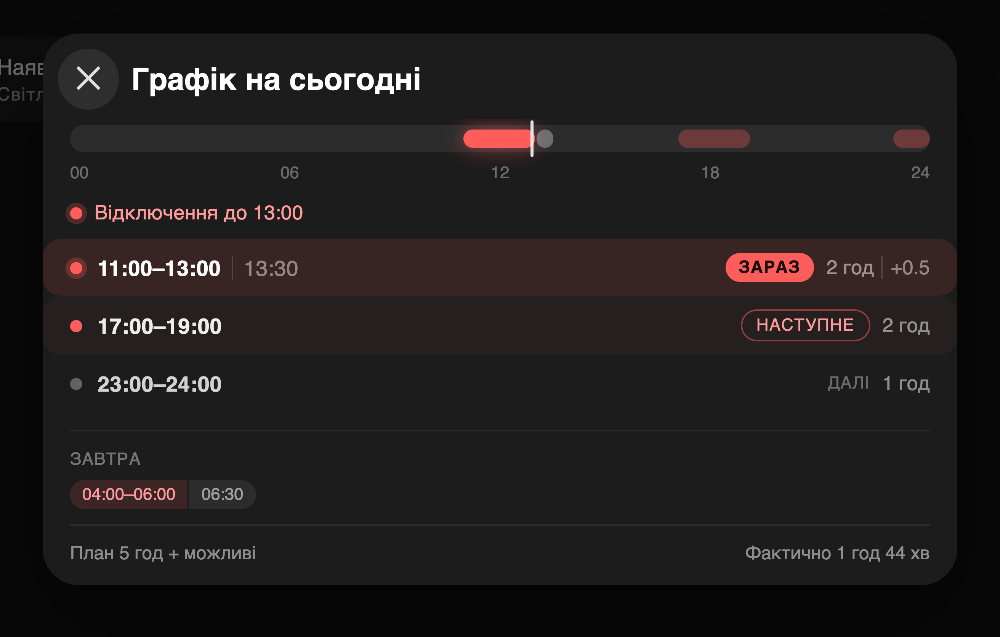

# Svitlo Poltava

Power outage schedule for **Poltava**, for Home Assistant. Choose your queue — 3.1 is the default.

The integration reads only the official Poltavaoblenergo page
`poe.pl.ua/customs/dynamicgpv-info.php`. No proxies, no other regions, no merge
of two APIs, no Python dependencies.

The Lovelace card is included. It is a power tile; tap it and the schedule
opens in a native dialog with the same look the dashboard used with
browser_mod — without browser_mod. HACS installs the integration, and the card
is loaded automatically; no manual resource entry.

## Screenshots




## Features

- Three states per half-hour slot: **on**, **off**, and **possible**.
- Today and tomorrow, when the operator publishes both.
- Next outage, next grid connection, minutes and hours to each.
- Outage hours for today and tomorrow, longest outage.
- One calendar entity with the outage windows.
- One config entry. The region is fixed; you choose the queue from the operator page.

## Installation

1. Open **HACS → Integrations**.
2. Open the three-dot menu → **Custom repositories**.
3. Add `https://github.com/e-potashkin/svitlo_poltava` with category
   **Integration**.
4. Install **Svitlo Poltava** and restart Home Assistant.
5. Go to **Settings → Devices & services → Add integration → Svitlo Poltava**.

Choose your queue from the list. The list comes from the operator page; 3.1 is the default.

## Card

The card is served from the integration and loaded on every page. Add it to a
dashboard:

```yaml
type: custom:svitlo-poltava-card
```

Every option is optional:

| Option | Default | Meaning |
| --- | --- | --- |
| `entity` | the only `sensor.svitlo_poltava_*_electricity` with a schedule | the schedule sensor |
| `presence_entity` | `binary_sensor.grid_present` if it exists, otherwise `binary_sensor.svitlo_poltava_{queue}_power_present` | the real light |
| `off_today_entity` | `sensor.grid_off_today` if it exists, otherwise none | measured outage hours; without it the footer prints `—` |
| `title` | `Наявність світла` / `Power present` | tile title |
| `dialog_title` | `Графік на сьогодні` / `Today's schedule` | dialog title |

The tile shows the real light and the current or next window. Tap it to open
the 24-hour rail, one row per window, tomorrow's windows, and the plan and
measured hours. The dialog is a native `<dialog>`: Escape and a backdrop click
close it, and the close button sits on the left like the browser_mod popup.

## Entities

The integration creates one device, **Svitlo Poltava {queue}** (for example, **Svitlo Poltava 3.1**). Replace `{queue}` with the queue you chose:

| Entity | State |
| --- | --- |
| `sensor.svitlo_poltava_{queue}_electricity` | `Grid ON`, `Grid OFF`, `Possible`, `No data` |
| `binary_sensor.svitlo_poltava_{queue}_power_present` | power present / absent |
| `binary_sensor.svitlo_poltava_{queue}_emergency_outages` | emergency flag |
| `sensor.svitlo_poltava_{queue}_next_outage` | next planned outage (timestamp) |
| `sensor.svitlo_poltava_{queue}_next_grid_connection` | next grid connection (timestamp) |
| `sensor.svitlo_poltava_{queue}_minutes_to_outage` | minutes to the next outage |
| `sensor.svitlo_poltava_{queue}_minutes_to_grid_connection` | minutes to the next connection |
| `sensor.svitlo_poltava_{queue}_next_power_off` | seconds to the next outage |
| `sensor.svitlo_poltava_{queue}_next_power_on` | seconds to the next connection |
| `sensor.svitlo_poltava_{queue}_schedule_updated` | schedule update time |
| `sensor.svitlo_poltava_{queue}_total_outage_today` | outage hours today |
| `sensor.svitlo_poltava_{queue}_total_outage_tomorrow` | outage hours tomorrow |
| `sensor.svitlo_poltava_{queue}_longest_outage` | longest outage |
| `calendar.svitlo_poltava_{queue}_outage_schedule` | calendar of outage windows |

Entity IDs are generated from the device and entity names. If your Home
Assistant language is not English, the IDs can differ; check
**Settings → Devices & services → Svitlo Poltava**.

The status sensor carries the full schedule in its attributes:
`today_48half`, `tomorrow_48half`, `next_change_at`, `next_outage_kind`,
`today_outage_hours`, `possible_hours_today`, `longest_outage_hours`,
`history_today_48half`, and `page_days`.

## Options

**Settings → Devices & services → Svitlo Poltava → Configure** changes two
things:

1. **Queue** — the list comes from the operator page. After a change the old
   entities and the old device are removed, and a new set is created with the
   new queue in its IDs.
2. **Update interval** — default 120 seconds, allowed range 60–600 seconds.

The card finds the schedule sensor automatically. If more than one queue entry
exists, set `entity` explicitly.

## Migration from `svitlo_live`

1. Note the entity IDs and templates that read `sensor.svitlo_*` or
   `calendar.svitlo_*`.
2. Remove the old **Svitlo.live Schedules** config entry and integration.
3. Install **Svitlo Poltava** and add its entry.
4. Point your templates, automations, and dashboards to the new entity IDs.

The component does not rename or remove another integration's entities.

## Data source

`https://www.poe.pl.ua/customs/dynamicgpv-info.php`

The page contains one or more day blocks with a 48-cell table per queue. The
parser is in `custom_components/svitlo_poltava/poe_gpv.py`; the coordinator maps
the queue from the config entry to the 48 half-hour slots.

## License

MIT. Based on [chaichuk/svitlo_live](https://github.com/chaichuk/svitlo_live);
the Poltava parser and the card packaging are local changes in this repository.
